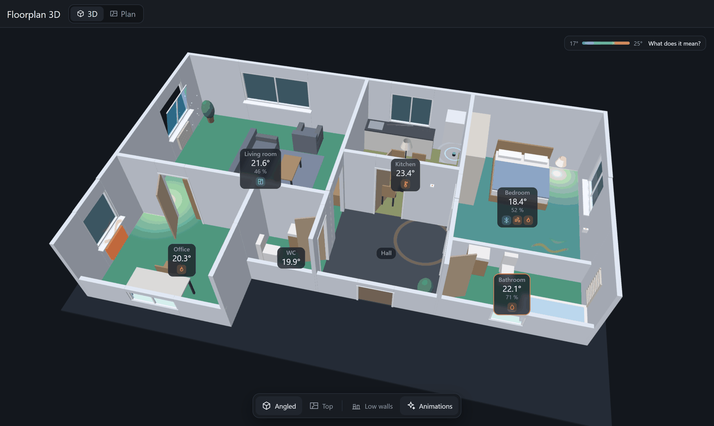
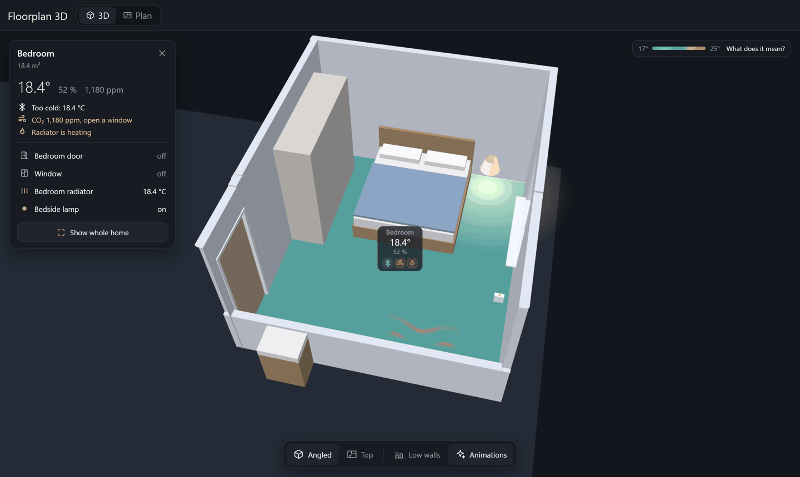
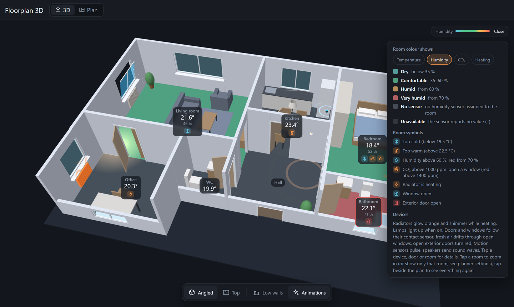
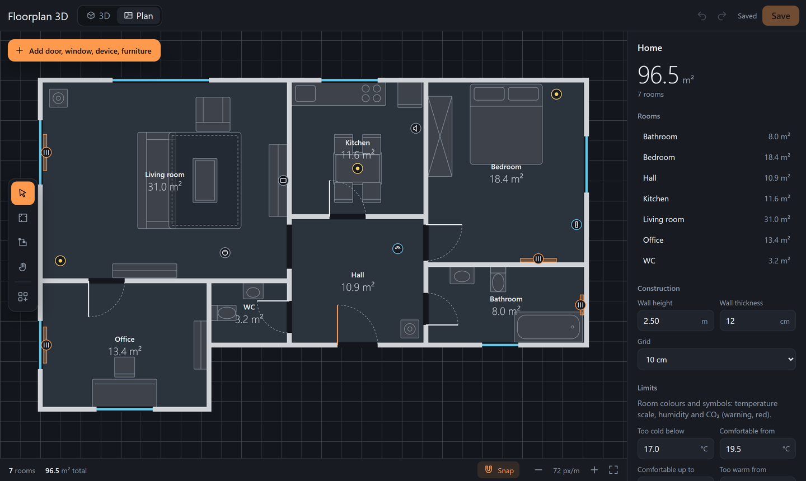
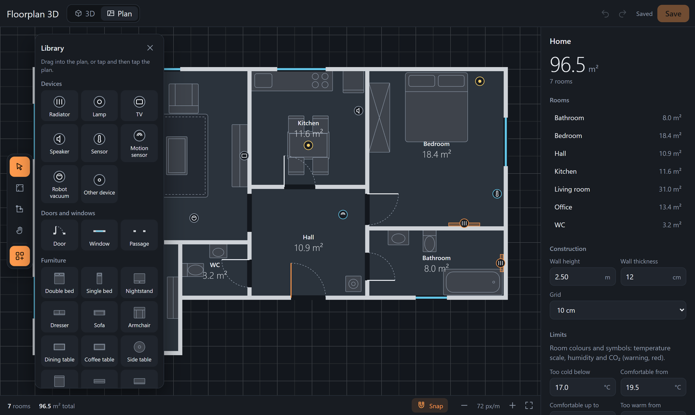
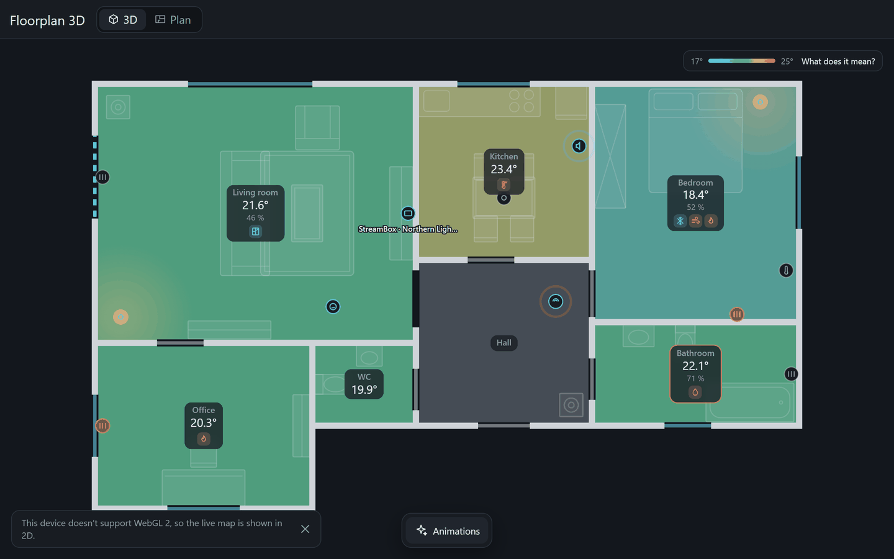
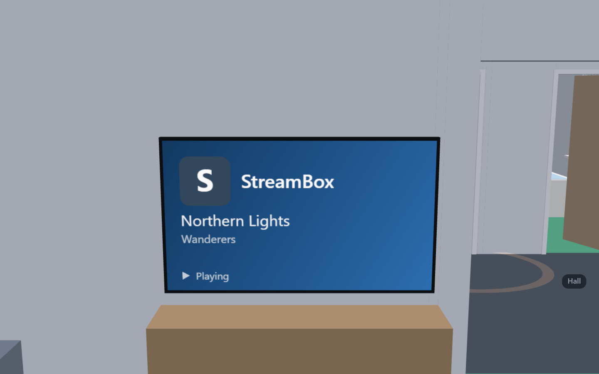
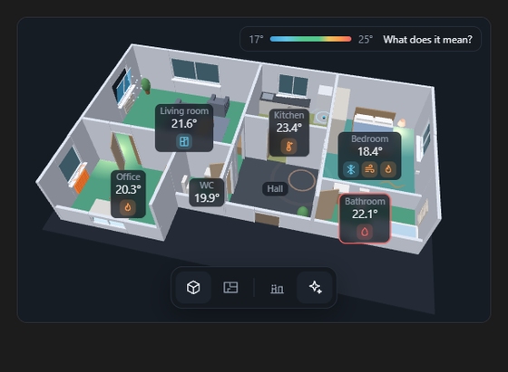
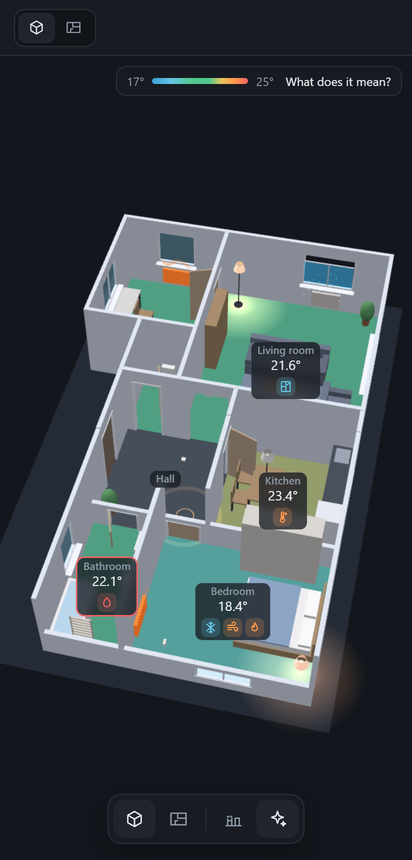

<p align="center">
  <picture>
    <source media="(prefers-color-scheme: dark)" srcset="docs/images/logo-dark.png">
    
  </picture>
</p>

<p align="center">
  Draw your home once and watch it live in 3D. Rooms are coloured by temperature,
  doors and windows open with their sensors, lamps glow and radiators heat.
</p>



Floorplan 3D is a custom integration for [Home Assistant](https://www.home-assistant.io/).
It adds its own sidebar panel with a 3D view of your home and a planner to draw it.
You draw rooms like in a room planner, with the mouse or a finger, and place your
entities on the plan. Everything runs locally in Home Assistant. There is no cloud
service and nothing is loaded from third parties.

Tested with Home Assistant 2026.10. Feedback and bug reports are welcome.

## Features

**3D view**
- A 3D model built from your plan with floors, walls, doors, windows and furniture.
  Orbit and zoom freely or use the angled and top presets.
- Walls between the camera and the rooms are lowered automatically, so you can look
  into every room. Walls behind a TV stay up.
- Tap a room to zoom in, or to show only that room, and see everything in it on a
  small card: readings, symbols and each device with its state. Tap beside the plan to
  see everything again.
- Houses with several floors: switch floors in the header, each floor has its own
  rooms and devices.
- Rooms are coloured by temperature, humidity, CO₂ or heating state. The legend
  explains every colour and symbol.
- Live devices: radiators glow while heating, lamps shine in their real colour, doors
  swing and windows tilt with their contact sensor, the TV shows the running app and
  title, robot vacuums and speakers show what they are doing.
- Subtle animations such as warm air above heating radiators or fresh air at open
  windows. They can be switched off per device and respect the system setting to
  reduce motion.
- Tap a device, door or window to open its Home Assistant dialog. Optionally, per
  device, a tap switches a lamp instead (hold for the dialog).
- Automatic lowering of the walls can be switched off per device with **Auto walls**.

**Planner**
- Draw rooms, move and resize them, edit corners for L shapes. Snapping, dimension
  lines and undo are built in.
- Import your Home Assistant areas as rooms and your floors as floors. Temperature and
  humidity sensors are suggested automatically.
- Stairs up, stairs down and spiral stairs, shown in 3D at the height of a storey.
- A library with devices, doors, windows, passages and 58 pieces of furniture in nine
  rooms, from corner sofas and bunk beds to kitchen islands. Search it, tap an entry to
  see it in 3D, then place it, or drag it straight onto the plan. Furniture snaps flush
  against walls and radiators slide along them.
- Trace an existing floor plan: upload a picture, set its scale with two clicks and
  draw the rooms on top.
- A welcome screen for the first start and a furnished demo home to try things out.
- Entities that were renamed or removed in Home Assistant are listed in the planner,
  so nothing goes missing silently.
- Plan export and import as JSON, adjustable limits for temperature, humidity and CO₂.

**Everywhere**
- English, German and Greek, following the language of your Home Assistant profile.
- Works on desktops, phones and tablets. Devices without WebGL 2 get a 2D live map
  with the same colours, symbols, devices and room cards; lamps light up their room and
  open doors show their leaf.
- Changes made on one device appear on all others right away.
- A dashboard card shows the same view on any Home Assistant dashboard.
- Only administrators can edit the plan. Everyone can view it.

| Show only one room | Humidity view with legend |
|---|---|
|  |  |

| Planner | Library | 2D live map |
|---|---|---|
|  |  |  |

| TV with app and title | Dashboard card | Phone |
|---|---|---|
|  |  |  |

## Installation

### HACS
1. In HACS, open the menu in the top right corner and choose **Custom repositories**.
2. Add `https://github.com/Rafail-Mathiou/ha-floorplan-3d` with the type
   **Integration**.
3. Install **Floorplan 3D** and restart Home Assistant.
4. Open **Settings**, **Devices & services**, **Add integration** and choose
   **Floorplan 3D**.

### Manual
1. Copy `custom_components/floorplan_3d` into the `custom_components` folder of your
   Home Assistant configuration.
2. Restart Home Assistant and add the integration as described above.

The panel appears in the sidebar as **Floorplan 3D**, or **Grundriss 3D** in German.

## Getting started
The first time you open the panel, it offers four ways to begin: your Home Assistant
areas as rooms, tracing a floor plan image, drawing by hand or a demo home. The steps
in detail:

1. Open **Plan** in the panel header.
2. Draw rooms with the room tool (`R`) or import your areas from Home Assistant. To
   trace a floor plan, upload a picture under **Background image** in the side panel,
   choose **Set scale**, click both ends of a wall you know the length of and enter
   that length.
3. Choose a temperature sensor, and if you have one a humidity sensor, for each room
   in the side panel. A `climate` entity works as well; its current temperature is
   used.
4. Open the library with **Add door, window, device, furniture** and drag entries onto
   the plan. Doors and windows snap onto walls. Give them a contact sensor and they
   open and close in 3D.
5. Save with **Save** or `Ctrl+S` and switch to **3D**.

For a home on several levels, add floors in the side panel under **Floors** or import
them from Home Assistant. Everything drawn before becomes the ground floor.

The side panel of the planner lists all keyboard shortcuts.

## Dashboard card
The integration also provides a dashboard card. There is no resource to add. Pick
**Floorplan 3D** in the card picker and set it up in the visual editor, or use YAML:

```yaml
type: custom:floorplan-3d-card
height: 420      # number in px or a CSS length such as 60vh
view: auto       # auto, or 2d to always show the 2D live map
controls: true   # set to false to hide the view buttons
floor: Upstairs  # optional: show only this floor (name or ID)
```

Without `floor`, a plan with several floors gets a floor switcher in the card. The
card follows changes from the planner live and opens the device dialog on tap.
The 3D code is only loaded on dashboards that contain the card.

## Room colours and symbols

| Colour | Meaning with the default limits |
|---|---|
| Blue | Too cold: below 19.5 °C, deep blue below 17 °C |
| Green | Comfortable: 19.5 to 22.5 °C |
| Yellow to orange | Warm: above 22.5 °C |
| Red | Too warm: from 25 °C |
| Grey | No sensor assigned, or the sensor is unavailable |

The legend (**What does it mean?** in the 3D view) switches the colours to humidity,
CO₂ or heating. Symbols on the room labels show when a room is too cold or too warm,
when humidity reaches 60 % (red from 70 %), when CO₂ is above 1000 ppm (red above
1400 ppm), when a radiator heats, when a window is open and when an exterior door is
open. You can change all limits in the planner side panel under **Limits**.

## Troubleshooting
- **"This device doesn't support WebGL 2"**: the browser or WebView has no WebGL 2, so
  the 2D live map is shown instead. On Android, updating *Android System WebView* or
  Chrome and enabling hardware acceleration in the kiosk browser often helps.
- **Changes are not visible after an update**: reload the browser.
- **A device is grey or missing**: open the planner. The side panel lists entities that
  no longer exist in Home Assistant; choose the new entity for each entry.
- **Saving reports that the plan changed**: it was saved on another device in the
  meantime. Reload to get that version, or keep yours with **Save my version**.

## Privacy
The plan is stored in your Home Assistant under `.storage/floorplan_3d` and is part of
your backups. Floorplan 3D reads entity states and opens dialogs. It only switches a
lamp if you turn on **A tap on a lamp switches it** in the legend, and only on that
device.

## Development
[docs/DEVELOPMENT.md](docs/DEVELOPMENT.md) explains building, testing and deploying,
[docs/ARCHITECTURE.md](docs/ARCHITECTURE.md) how the parts fit together and
[docs/DATA_MODEL.md](docs/DATA_MODEL.md) the stored format. Planned work is listed in
[docs/ROADMAP.md](docs/ROADMAP.md). Contributions are welcome, please read
[CONTRIBUTING.md](CONTRIBUTING.md) first. Security issues go through
[SECURITY.md](SECURITY.md).

## License
[MIT](LICENSE). The frontend bundle includes [three.js](https://threejs.org/) (MIT) and
[Lit](https://lit.dev/) (BSD-3-Clause).
